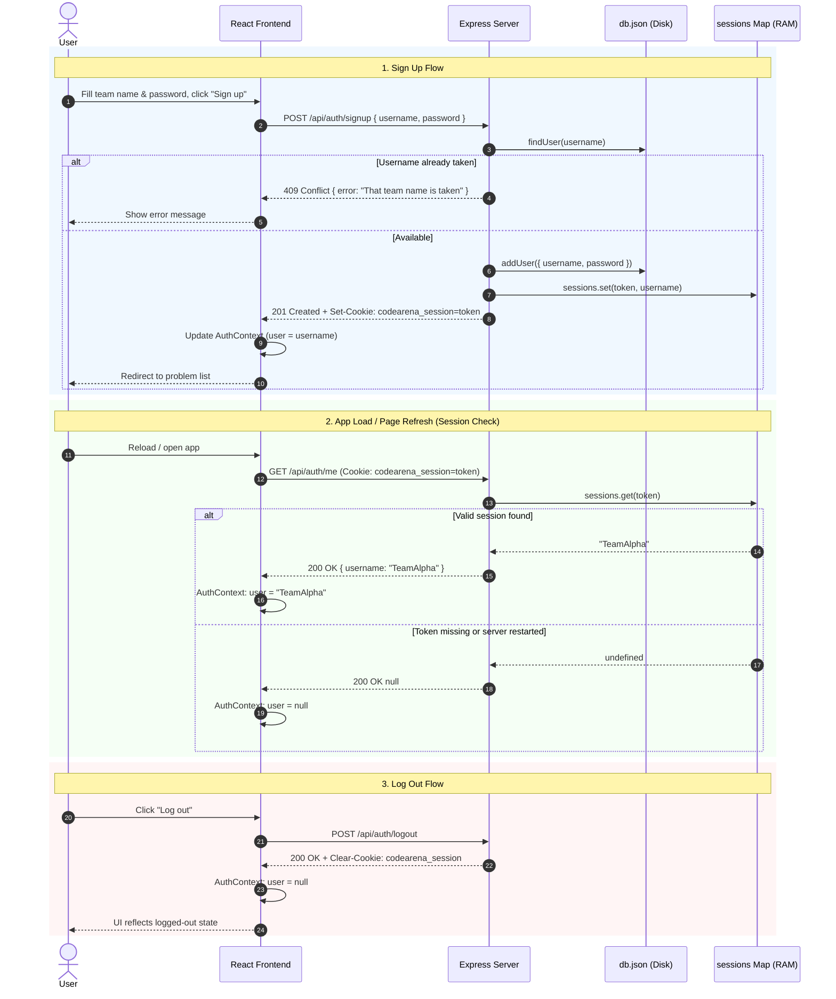
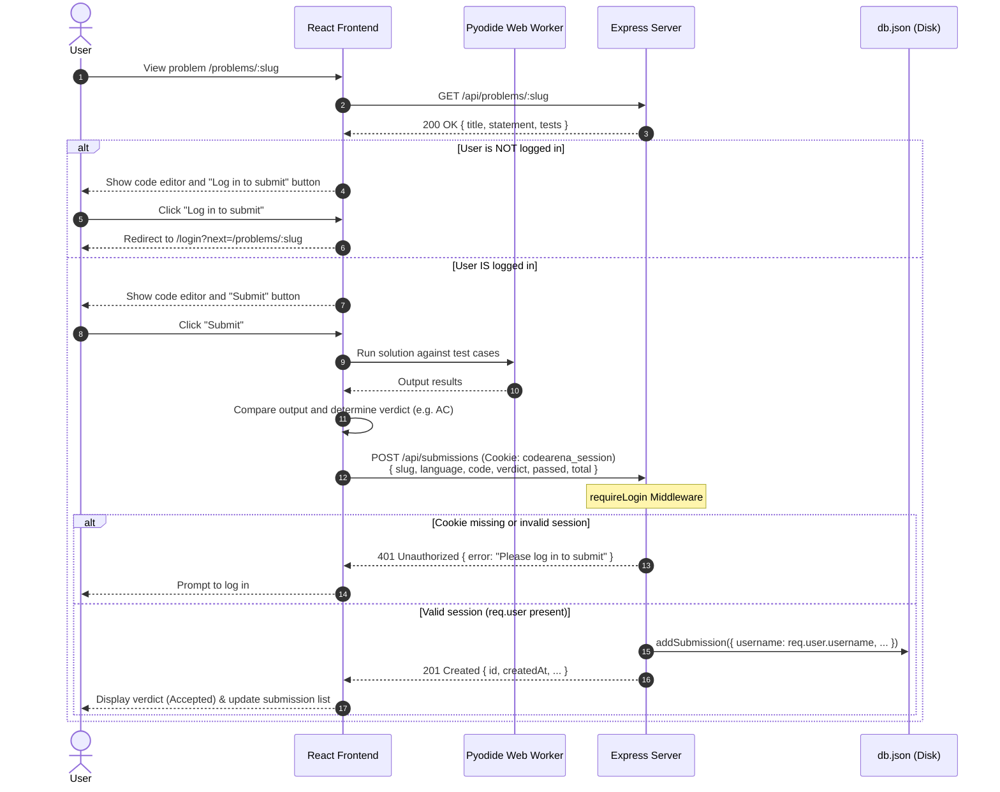

# Authentication & Session Architecture

This document explains how user accounts, sessions, and submissions work in CodeArena, including the design rationale, storage mechanisms, step-by-step request lifecycles, and sequence diagrams.

---

## Table of Contents

- [Why Browsing is Open but Submitting Needs an Account](#why-browsing-is-open-but-submitting-needs-an-account)
- [Where Accounts and Sessions are Stored](#where-accounts-and-sessions-are-stored)
  - [Account Storage (Persistent Disk)](#account-storage-persistent-disk)
  - [Session Storage (In-Memory RAM)](#session-storage-in-memory-ram)
  - [Why Server Restarts Invalidate All Sessions](#why-server-restarts-invalidate-all-sessions)
- [Step-by-Step Authentication & Submission Lifecycle](#step-by-step-authentication--submission-lifecycle)
  - [Overview of Routes and Cookies](#overview-of-routes-and-cookies)
  - [1. Sign Up (`POST /api/auth/signup`)](#1-sign-up-post-apiauthsignup)
  - [2. Log In (`POST /api/auth/login`)](#2-log-in-post-apiauthlogin)
  - [3. Session Check / App Hydration (`GET /api/auth/me`)](#3-session-check--app-hydration-get-apiauthme)
  - [4. Solving and Submitting (`POST /api/submissions`)](#4-solving-and-submitting-post-apisubmissions)
  - [5. Log Out (`POST /api/auth/logout`)](#5-log-out-post-apiauthlogout)
- [Sequence Diagrams](#sequence-diagrams)
  - [Authentication Lifecycle Diagram](#authentication-lifecycle-diagram)
  - [Problem Solving & Submission Diagram](#problem-solving--submission-diagram)
- [Key Files Reference](#key-files-reference)

---

## Why Browsing is Open but Submitting Needs an Account

Similar to platforms like **LeetCode**, CodeArena allows anyone to freely browse the problem list, read problem descriptions, and write code in the browser editor without logging in.

### 1. Frictionless Exploration & Client-Side Execution
CodeArena does not execute user code on the backend server. Python solutions run entirely **inside the user's browser** via [Pyodide](https://pyodide.org/) (Python compiled to WebAssembly) in a sandboxed Web Worker. Because running tests does not consume server compute or pose remote code execution risks, there is no need to restrict read-only browsing or code experimentation behind an authentication wall.

### 2. Leaderboard Integrity & Team Attribution
While browsing and local testing are free, **submitting a solution** writes a record to the shared event database:
- **Team Attribution**: Every submission must be linked to a registered team (`username`) so scores can be calculated.
- **Fair Competition**: Requiring authentication prevents anonymous or duplicate spamming that could skew problem metrics or manipulate the public leaderboard.
- **Progress Tracking**: Teams can view their previous submission verdicts for each problem across browser tabs and reloads.

If an unauthenticated user attempts to click **"Log in to submit"** on a problem page, the client redirects them to:
```
/login?next=/problems/<slug>
```
Once logged in, they are immediately redirected back to the problem they were solving.

---

## Where Accounts and Sessions are Stored

### Account Storage (Persistent Disk)
Team credentials and submissions are stored in a lightweight JSON database file at:
```
server/data/db.json
```
- Managed in `server/db.js` using Node's `fs` module (`load()` and `save()`).
- When a team registers via `addUser({ username, password })`, their record is appended to the `users` array in `db.json`.
- **Durability**: Because account data is stored on disk, registered teams and their passwords survive server restarts.

### Session Storage (In-Memory RAM)
Active login sessions are maintained purely **in memory** inside `server/auth.js`:
```javascript
const sessions = new Map(); // token -> username
```
- When a user signs up or logs in, the server generates a cryptographically random 24-byte hex token (`crypto.randomBytes(24).toString('hex')`).
- The token maps directly to the team's username inside the in-memory `Map`.
- The token is sent to the client as an HTTP cookie named `codearena_session`.

### Why Server Restarts Invalidate All Sessions

Because `sessions` is a JavaScript `Map` living in the Node.js process heap memory:
1. When the server process restarts (or crashes, redeploys, or is terminated), the Node process exits and volatile RAM is cleared.
2. When the server starts up again, `sessions` initializes as an empty `Map`.
3. Even though client browsers may still send the `codearena_session` cookie in subsequent HTTP requests, `sessions.get(token)` returns `undefined`.
4. As a result, `currentUser` middleware assigns `req.user = null`, and any protected endpoint (like submitting solutions) responds with `401 Unauthorized`.
5. Everyone must log in again so that a new session token can be issued and added to the server's in-memory `Map`.

> **Note**: This trade-off is intentional for HackDay. It avoids the operational overhead of installing, configuring, and managing an external session store (such as Redis or SQLite) during a fast-paced one-day hackathon.

---

## Step-by-Step Authentication & Submission Lifecycle

### Overview of Routes and Cookies

| Route | Method | Protected? | Description |
|---|---|---|---|
| `/api/auth/signup` | `POST` | No | Creates user in `db.json`, sets cookie, returns `{ username }`. |
| `/api/auth/login` | `POST` | No | Validates credentials, sets cookie, returns `{ username }`. |
| `/api/auth/me` | `GET` | No | Returns `{ username }` if valid cookie present, else `null`. |
| `/api/auth/logout` | `POST` | No | Clears `codearena_session` cookie. |
| `/api/submissions` | `POST` | Yes (`requireLogin`) | Records judged submission for the authenticated team. |

#### The Session Cookie
- **Name**: `codearena_session`
- **Value**: 48-character hex string (e.g., `4f9b8c...`)
- **Options**:
  - `httpOnly: true`: Prevents client-side scripts (`document.cookie`) from accessing the session token (protects against XSS).
  - `sameSite: 'lax'`: Protects against Cross-Site Request Forgery (CSRF) while allowing normal top-level navigations.
  - `maxAge: 86400000`: Valid for 24 hours (1 day).

---

### 1. Sign Up (`POST /api/auth/signup`)
1. User enters team name and password on `/signup` and clicks **Create team account**.
2. Client sends:
   ```http
   POST /api/auth/signup
   Content-Type: application/json

   { "username": "TeamAlpha", "password": "secretPassword123" }
   ```
3. Backend checks:
   - Validates that `username` and `password` are non-empty strings (returns `400` if missing).
   - Calls `findUser(username)` from `server/db.js`. If the team already exists, returns `409 Conflict` (`{ "error": "That team name is taken" }`).
4. Creates account:
   - Calls `addUser({ username, password })`, appending the user to `server/data/db.json`.
5. Establishes session:
   - Generates a 24-byte random hex token via `crypto.randomBytes(24).toString('hex')`.
   - Stores mapping: `sessions.set(token, username)`.
   - Attaches `Set-Cookie: codearena_session=<token>; HttpOnly; SameSite=Lax; Max-Age=86400` header to response.
6. Returns `201 Created` with `{ "username": "TeamAlpha" }`.
7. React's `AuthContext` updates its `user` state to `{ username: "TeamAlpha" }`.

---

### 2. Log In (`POST /api/auth/login`)
1. User enters team name and password on `/login` and clicks **Log in**.
2. Client sends:
   ```http
   POST /api/auth/login
   Content-Type: application/json

   { "username": "TeamAlpha", "password": "secretPassword123" }
   ```
3. Backend checks:
   - Calls `findUser(username)`. If no record is found, returns `401 Unauthorized` (`{ "error": "No team with that name" }`).
   - Checks `user.password !== password`. If incorrect, returns `401 Unauthorized` (`{ "error": "Wrong password" }`).
4. Establishes session:
   - Generates a new random hex token.
   - Saves `sessions.set(token, user.username)` in RAM.
   - Sets the `codearena_session` cookie via `res.cookie()`.
5. Returns `200 OK` with `{ "username": "TeamAlpha" }`.
6. Client updates `AuthContext` and navigates to the previous page (or `/`).

---

### 3. Session Check / App Hydration (`GET /api/auth/me`)
1. When a user opens or refreshes the page in their browser, `AuthProvider` (`client/src/auth.jsx`) mounts.
2. It sends an initial request:
   ```http
   GET /api/auth/me
   Cookie: codearena_session=<token>
   ```
3. Express executes the `currentUser` middleware:
   - Reads `req.headers.cookie` and extracts `codearena_session`.
   - Looks up the token in `sessions.get(token)`.
   - If found, sets `req.user = { username }`. If missing or invalid, sets `req.user = null`.
4. The `/api/auth/me` handler returns `req.user` (`{ username: "..." }` or `null`).
5. Client sets `user` in `AuthContext` and toggles `checking = false`.

---

### 4. Solving and Submitting (`POST /api/submissions`)
1. User navigates to `/problems/:slug`.
2. If the user is unauthenticated (`user === null`), the button displays **Log in to submit**. Clicking it redirects to `/login?next=/problems/:slug`.
3. If authenticated (`user !== null`), the button displays **Submit**.
4. When the user clicks **Submit**:
   - The React app runs their code in a sandboxed Web Worker running Pyodide.
   - The browser compares test case outputs against expected outputs and produces a verdict (`AC`, `WA`, `TLE`, etc.).
5. The browser posts the result to the server:
   ```http
   POST /api/submissions
   Content-Type: application/json
   Cookie: codearena_session=<token>

   {
     "slug": "hello-arena",
     "language": "python",
     "code": "print('Hello, Arena!')",
     "verdict": "AC",
     "passed": 1,
     "total": 1
   }
   ```
6. The route is guarded by `requireLogin` middleware:
   - Checks `req.user`. If null, rejects with `401 Unauthorized` (`{ "error": "Please log in to submit" }`).
7. The server calls `addSubmission(...)`, writing the submission to `server/data/db.json` tagged with `req.user.username`.
8. Returns `201 Created` with the saved submission record. The problem page refreshes its submission history.

---

### 5. Log Out (`POST /api/auth/logout`)
1. User clicks **Log out** in the navigation bar.
2. Client sends:
   ```http
   POST /api/auth/logout
   ```
3. Server executes `res.clearCookie('codearena_session')` which sends an expired cookie header:
   ```http
   Set-Cookie: codearena_session=; Path=/; Expires=Thu, 01 Jan 1970 00:00:00 GMT
   ```
4. Server responds with `200 OK` (`{ "ok": true }`).
5. Client updates `AuthContext` setting `user = null`.

---

## Sequence Diagrams

### Authentication Lifecycle Diagram



---

### Problem Solving & Submission Diagram



---

## Key Files Reference

- **[`server/auth.js`](../server/auth.js)**:
  - `sessions`: The in-memory `Map` storing session token mappings.
  - `startSession(res, username)`: Generates session token and sets `codearena_session` cookie.
  - `currentUser(req, res, next)`: Reads cookie and populates `req.user`.
  - `requireLogin(req, res, next)`: Middleware guarding protected endpoints (returns `401` if unauthenticated).
  - `authRoutes(app)`: Registers `/api/auth/signup`, `/api/auth/login`, `/api/auth/logout`, and `/api/auth/me`.

- **[`server/db.js`](../server/db.js)**:
  - `addUser({ username, password })`: Appends new user record to `server/data/db.json`.
  - `findUser(username)`: Retrieves existing user from `server/data/db.json`.

- **[`server/index.js`](../server/index.js)**:
  - Attaches `currentUser` middleware globally to all requests.
  - Protects `POST /api/submissions` with `requireLogin`.

- **[`client/src/auth.jsx`](../client/src/auth.jsx)**:
  - `AuthProvider` context managing `user`, `checking`, `login`, `signup`, and `logout` across the frontend.
  - Automatically queries `/api/auth/me` on initial render.

- **[`client/src/pages/ProblemPage.jsx`](../client/src/pages/ProblemPage.jsx)**:
  - Handles the submission button logic, conditional redirect to `/login?next=...`, Pyodide worker execution, and posting to `/api/submissions`.

