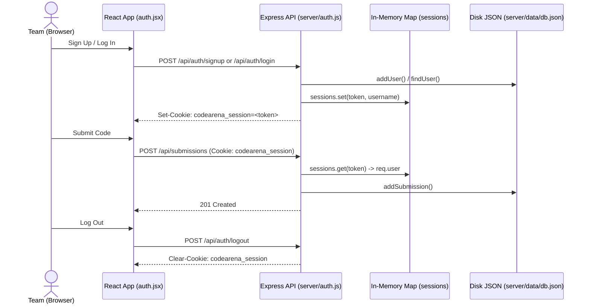

# Authentication & Sessions in CodeArena

## 1. Why Browsing is Open, Why Submitting Requires an Account
Like LeetCode, CodeArena allows any visitor to browse problems (GET /api/problems), view problem descriptions (GET /api/problems/:slug), and run Python code inside their browser via Pyodide Web Workers without logging in.

However, **submitting** a solution (POST /api/submissions) requires a logged-in team account (enforced by 
equireLogin in server/auth.js) so that:
- Every submission in server/data/db.json is tied to a verified username (team name).
- The leaderboard (/api/leaderboard) and submission history (/api/submissions) accurately track team progress.

## 2. Step-by-Step Authentication & Submission Flow
- **Sign Up (POST /api/auth/signup):** Validates username and password, checks indUser(username) (409 if taken), saves the account to server/data/db.json via ddUser(), calls startSession(res, username) to store a 24-byte hex token in the in-memory sessions Map, and sets the codearena_session HTTP-only cookie (httpOnly: true, sameSite: 'lax', maxAge: 24h).
- **Log In (POST /api/auth/login):** Verifies credentials via indUser(username) (401 on error), calls startSession(res, user.username) to store a new token in sessions and set the codearena_session cookie, and returns { username }.
- **Session Check (GET /api/auth/me):** On every request, currentUser reads codearena_session from 
eq.headers.cookie, looks up the token in sessions, and sets 
eq.user = { username } (or 
ull).
- **Submit (POST /api/submissions):** 
equireLogin checks 
eq.user (401 if missing) before recording the submission via ddSubmission() in server/data/db.json.
- **Log Out (POST /api/auth/logout):** Calls 
es.clearCookie('codearena_session') and returns { ok: true }.

## 3. Storage & Why Server Restarts Require Logging In Again
- **Accounts & Submissions:** Stored permanently on disk in server/data/db.json (via server/db.js).
- **Active Sessions:** Stored purely in server RAM inside const sessions = new Map() in server/auth.js.
- **Server Restart Behavior:** When the Node server restarts, the in-memory sessions Map is wiped empty. Even though the browser still sends the codearena_session cookie, its token is no longer in sessions, so 
eq.user is 
ull and everyone must log in again.

## 4. Sequence Diagram

