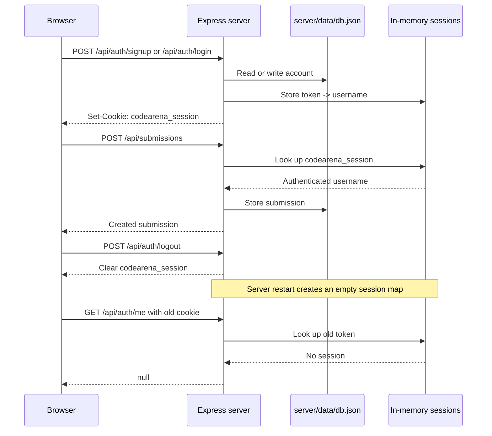

# Authentication

CodeArena uses team accounts. Browsing problems is public, but submitting code
requires a logged-in account.

## Why an account is required to submit

The server allows anyone to read problems through the public problem routes.
The submission route is protected by the `requireLogin` middleware. If there is
no authenticated user, the server returns HTTP `401` with
`Please log in to submit`.

The browser runs and judges submitted code locally. After judging, it reports
the result to the server, where the submission is stored with the team
username.

## Authentication flow

### 1. Sign up

The client sends a `POST` request to:

```text
/api/auth/signup
```

with a JSON body containing `username` and `password`.

The server:

1. Trims the username and reads the password.
2. Rejects missing values with HTTP `400`.
3. Rejects an existing username with HTTP `409`.
4. Stores the new account.
5. Starts a session and returns HTTP `201` with the username.

The client calls this route through `api.signup()` in
[`client/src/api.js`](../client/src/api.js).

### 2. Log in

The client sends a `POST` request to:

```text
/api/auth/login
```

with a JSON body containing `username` and `password`.

The server looks up the account and compares the submitted password. An
unknown username or incorrect password returns HTTP `401`. On success, the
server starts a session and returns the username.

The client calls this route through `api.login()` in
[`client/src/api.js`](../client/src/api.js).

### 3. Submit code

On a problem page, the browser first judges the code locally. If no user is
logged in, the client redirects to the login page instead of submitting.

After judging, the client sends a `POST` request to:

```text
/api/submissions
```

The request includes the username, problem slug, language, code, verdict,
passed test count, and total test count. The server applies `requireLogin`,
then stores the submission in the database.

The client calls this route through `api.submit()` in
[`client/src/api.js`](../client/src/api.js). The submission flow is in
[`client/src/pages/ProblemPage.jsx`](../client/src/pages/ProblemPage.jsx).

### 4. Log out

The client sends a `POST` request to:

```text
/api/auth/logout
```

The server clears the session cookie and returns:

```json
{ "ok": true }
```

The client then clears its logged-in user state. The client calls this route
through `api.logout()` in [`client/src/api.js`](../client/src/api.js).

## Session cookie

The session cookie is named:

```text
codearena_session
```

When signup or login succeeds, the server generates a random token and sends
it in this cookie. The cookie is configured as `httpOnly`, `sameSite: 'lax'`,
and has a maximum age of 24 hours.

For each request, the server reads this cookie and looks up its token in the
session map. The current user is placed on `req.user`.

The server also exposes `GET /api/auth/me`, which returns the current user or
`null`. The client uses this route when the application starts to restore its
current authentication state.

## Storage

### Accounts and submissions

Accounts and submissions are stored in the JSON file:

```text
server/data/db.json
```

The path is defined in `server/db.js`. The file contains `users` and
`submissions` arrays. The directory and file are created when data is saved.

### Sessions

Sessions are stored in memory in the Node.js process:

```js
const sessions = new Map(); // token -> username
```

Sessions are not written to `server/data/db.json`.

## Why login is required again after a server restart

Restarting the server creates a new, empty in-memory session map. The browser
may still have the `codearena_session` cookie, but its token is no longer in
the new map. The server therefore cannot associate that cookie with a
username, so the user is treated as logged out and must sign in again.

## Sequence diagram


